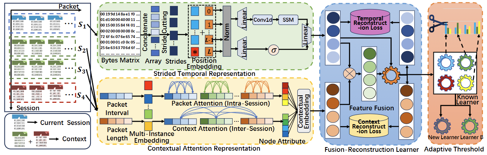

# Bident

**"Bident: Towards the Detection of Stealthy Unknown Traffic with Time-Context Fusion"** (Zhibo Yang, Ziqi Yang, Yang Xiao, Fan Zhang).

The overall framework is illustrated below.

<!-- Replace this placeholder with your framework figure -->
 

## How it works

```
                 ┌─ STR  bytes ─► non-overlapping strides ─► selective SSM ───────► Z_t ─┐
 pcap ─► flows ──┤                                                                       ├─► FRL: cross-attention fusion
 (1 file         └─ CAR  packet length/interval ─► packet attention (intra-session)      │        + reconstruct Z_t and Z_c
  = 1 class)           ─► session attention over a causal context window ─────► Z_c ─────┘        (shared, trained once, frozen)

 for every known class i:   AE_t(Z_t) → L_t    AE_c(Z_c) → L_c      one independent learner per class
 DAT:                       T = μ_k* − α·σ_k*  from a BIC-selected GMM of the training losses, per class and per branch
 dual verification:         accept as class i only if argmin_i L_t and argmin_i L_c are both under their thresholds
                            AND point to the same learner; otherwise the flow is "unknown"
 discovery:                 unknown flows → buffer → (≥ N_B flows) DBSCAN on Pool(E_f) → one new learner per cluster
                            (existing learners and thresholds are never retrained)
```

Because every class owns its learner and its thresholds, new classes are added without touching the old ones.

## Repository layout

```
run_bident.py            command line: `run` (train + evaluate) and `predict`
config.py                all hyper-parameters (defaults = Table III of the paper)
pcap_io.py               pure-Python pcap/pcapng reader, flow assembly, features, causal context windows
model.py                 STR / CAR / FRL / single-class AutoEncoders (PyTorch)
detector.py              training, DAT calibration, dual verification, buffer + incremental class discovery
dat.py                   (no torch) DAT, Algorithm 1, DBSCAN discovery, Hungarian-matched evaluation
make_synthetic_pcaps.py  writes 5 synthetic traffic classes for smoke tests
requirements.txt
```

## Installation

Python ≥ 3.9.

```bash
pip install -r requirements.txt     # numpy, scipy, scikit-learn, torch
```

No packet library (scapy/dpkt) is needed. Optional: install [`mamba_ssm`](https://github.com/state-spaces/mamba) and pass `--use_mamba_ssm` to replace the pure-PyTorch scan with the fused CUDA kernel (much faster).

## Input data

```
pcaps/
├── Zeus.pcap          → class "Zeus"
├── Virut.pcap         → class "Virut"
└── Benign.pcapng      → class "Benign"
```

- Accepted extensions: `.pcap`, `.pcapng`, `.cap`. Class names must be unique.
- Link types: Ethernet (with VLAN tags), raw IP, Linux cooked v1/v2, BSD loopback; IPv4 and IPv6.
- A **flow** is a bidirectional 5-tuple, closed after `--idle_timeout` seconds of silence; flows with fewer than `--min_pkts` packets are dropped. At most `--max_flows` flows (earliest first) are read from each pcap.
- Per flow: the first `n_pkt` packets × `pkt_len` bytes from the IP header on (→ STR), and for the first `m` packets the signed length and log inter-arrival time (→ CAR).
- By default IP addresses, transport ports and the IPv4 checksum are zeroed (`--no-mask_addr` to keep them) so the model cannot shortcut on addresses.
- **Context window** of a flow = itself plus the `n_ctx−1` flows that started before it in the *same pcap*. It is strictly causal — no future flow is ever used.

## Quick start

```bash
# 1. smoke test on synthetic traffic (small configuration)
python make_synthetic_pcaps.py --out_dir demo_pcaps --flows 300
python run_bident.py run --data_dir demo_pcaps --out_dir out_demo \
       --n_pkt 16 --pkt_len 64 --n_ctx 16 --epochs 5 --ae_epochs 10 --buffer 60

# 2. your own data, paper configuration (GPU recommended)
python run_bident.py run --data_dir /path/to/pcaps --out_dir out --cache flows.npz

# choose the initially known class(es) yourself …
python run_bident.py run --data_dir /path/to/pcaps --known Zeus,Virut
# … or let a seed pick 3 of them
python run_bident.py run --data_dir /path/to/pcaps --n_known 3 --seed 1

# 3. classify new traffic with a saved model
python run_bident.py predict --model out/bident.pt --input new.pcap --out pred.csv
python run_bident.py predict --model out/bident.pt --input new_pcaps/ --out pred.csv --discover
```

The paper reports the mean of three runs with different random class partitions:

```bash
for s in 0 1 2; do
  python run_bident.py run --data_dir /path/to/pcaps --out_dir out_seed$s --seed $s --cache flows.npz
done
```

### What `run` does

Following the paper's evaluation protocol:

1. Parse every pcap into flows and split each class into train / test (`--test_ratio`).
2. Only `--n_known` classes are known; all others are withheld from training and treated as unknown.
3. Train STR + CAR + FRL on the known classes with the fusion-reconstruction loss, then freeze them.
4. Train one (temporal AE, contextual AE) learner per known class and fit its two DAT thresholds.
5. Stream the test flows of **all** classes through dual verification; rejected flows go to the buffer; whenever it holds `--buffer` flows, DBSCAN on the fused descriptors creates new learners.
6. Match discovered clusters to the true unknown classes with the Hungarian algorithm.

### Outputs (`--out_dir`)

| file | content |
|---|---|
| `metrics.json` | ACC, macro precision / recall / F1, AMI, per-class F1, cluster→class matching, class-agnostic known-vs-unknown P/R/F1 |
| `predictions.csv` | per test flow: `flow_start, true_class, pred_learner, pred_class, first_pass_unknown` |
| `bident.pt` | encoder, learners, thresholds — for `predict` |

`predict` writes `file, flow_start, pred` where `pred` is a known class name, `new_k` (a class discovered with `--discover`), or `unknown`. Discovered learners have no real name, so they are numbered.

## Options

Everything is a command-line flag of `run`; `config.py` is the full list. Defaults marked **paper** are Table III; the rest are implementation choices (see below).

| flag | default | meaning |
|---|---|---|
| `--n_pkt` / `--pkt_len` / `--stride` | 64 / 128 / 8 | **paper** N_p / L_p / L_s (stride must divide pkt_len) |
| `--d` | 256 | **paper** SSM hidden size (= d_t) |
| `--m` / `--d_c` / `--n_ctx` | 10 / 128 / 64 | **paper** packets per session / CAR size / sessions in the context window |
| `--h` | 128 | **paper** AutoEncoder hidden size |
| `--k_max` / `--gmm_iter` / `--alpha` | 7 / 100 / 2 | **paper** max GMM components / GMM iterations / threshold strictness |
| `--buffer` | 100 | **paper** buffer size N_B that triggers DBSCAN |
| `--batch_size` / `--epochs` / `--lr` / `--dropout` | 64 / 30 / 1e-4 / 0.2 | **paper** shared-representation training |
| `--d_f` | 128 | fused dimension (not given in the paper) |
| `--anchor_w` | 1.0 | weight of the anti-collapse anchor loss; `0` = paper-literal |
| `--thr_floor_q` | 0.9 | DAT threshold is at least this quantile of the training losses; `0` = paper-literal |
| `--eps` / `--min_samples` / `--min_cluster` | 0 (auto) / 5 / 10 | DBSCAN eps (0 = 90th percentile of the k-NN distance), its `min_samples`, smallest cluster that becomes a learner |
| `--ae_epochs` / `--ae_lr` / `--ae_min_steps` / `--ae_max_samples` | 30 / 1e-3 / 300 / 1500 | training of each single-class learner |
| `--known` / `--n_known` | "" / 1 | comma-separated known class names, or how many random classes are known |
| `--test_ratio` / `--seed` / `--device` | 0.3 / 0 / auto | split, seed, `cuda`/`cpu` |
| `--idle_timeout` / `--max_flows` / `--min_pkts` / `--mask_addr` | 120 / 2000 / 2 / on | flow assembly (see Input data) |
| `--cache` | – | `.npz` file that caches the parsed flows between runs |
| `--use_mamba_ssm` | off | use the CUDA `mamba_ssm` kernel |

## Paper ↔ code

| paper | where |
|---|---|
| STR: stride cutting Eq. 1–3, selective SSM Eq. 4–9 | `model.py` — `STR`, `SSMBlock` |
| CAR: multi-instance packet attention Eq. 10–13, inter-session attention Eq. 14 | `model.py` — `CAR` |
| FRL: cross-attention fusion Eq. 15–18, dual reconstruction Eq. 19–25 | `model.py` — `FRL`, `BidentEncoder` |
| single-class learner: two FC AutoEncoders with ReLU (Fig. 4) | `model.py` — `SingleClassLearner` |
| DAT: GMM + BIC, component with the largest mean, Eq. 26–29 | `dat.py` — `fit_dat_threshold` |
| dual verification, Algorithm 1 | `dat.py` — `dual_verify` |
| buffer, DBSCAN on Pool(E_f), incremental learning, Hungarian matching | `detector.py` — `run_stream`; `dat.py` |

## Differences from the paper

The paper leaves some details open and I made these choices. They are the first places to look if results differ.

1. **Context window.** The paper says the contextual subgraph uses only earlier flows but not how it is built. Here: the target flow plus the previous `n_ctx−1` flows of the same pcap, ordered by start time.
2. **Anti-collapse.** FRL reconstructs Z_t and Z_c, which are themselves trained, so the objective can be minimised by collapsing them. I detach the reconstruction targets and add a light anchor loss that keeps Z_t / Z_c able to recover the raw bytes / packet features. `--anchor_w 0` removes the anchor (the detach stays).
3. **Single-class learner.** The text says two independent AutoEncoders; Fig. 4 draws a fusion block between encoder and decoder. I implemented the text: two independent AEs on Z_t and Z_c. The fused E_f shapes Z_t / Z_c through FRL training and is the DBSCAN descriptor.
4. **DAT floor.** If BIC picks one component, μ − 2σ rejects most of the class's own training samples (on a synthetic unimodal loss it accepted only 1.2 %). The threshold is therefore also kept above the 90th percentile of the training losses. `--thr_floor_q 0` is Eq. 29 exactly.
5. **SSM.** A unidirectional selective scan written in pure PyTorch (sequence length N_s = 1024 by default, gradient-checkpointed per chunk). It is slow; use a GPU, reduce `--n_pkt`/`--pkt_len`, or use `mamba_ssm`.
6. **DBSCAN.** The paper does not give eps; it is estimated automatically and descriptors are standardised first. Clusters smaller than `--min_cluster` do not become a learner.
7. **Single run.** One invocation = one seed; the paper's three-run average is the loop above.
8. **Not implemented:** baselines, ROC/AUC and FPR, the robustness / cross-dataset / drift experiments, and dataset download or preprocessing for IDS2017&2018, CrossNet2021, USTC-TFC2016, ISCXVPN2016.

## Testing status

- **Tested** on synthetic pcaps (5 classes): pcap parsing, flow assembly, causal context windows, address masking, cache round trip, DAT thresholds, dual verification, DBSCAN discovery with Hungarian-matched evaluation, and the buffer / incremental-learning bookkeeping (the last one with the network replaced by an oracle).
- **Not tested:** the PyTorch code (`model.py`, and the training / inference parts of `detector.py` and `run_bident.py`) was only syntax-checked, because the machine it was written on had no PyTorch. Expect that a first run may surface shape or dtype bugs — please open an issue.
- No attempt has been made to reproduce the paper's numbers.

## Citation

If you use the method, cite the paper (fill in the final venue and year):

```bibtex
@misc{yang2026bident,
  title  = {Bident: Towards the Detection of Stealthy Unknown Traffic with Time-Context Fusion},
  author = {Yang, Zhibo and Yang, Ziqi and Xiao, Yang and Zhang, Fan},
  note   = {Manuscript; official code: https://github.com/yang123-cloud/bident}
}
```
